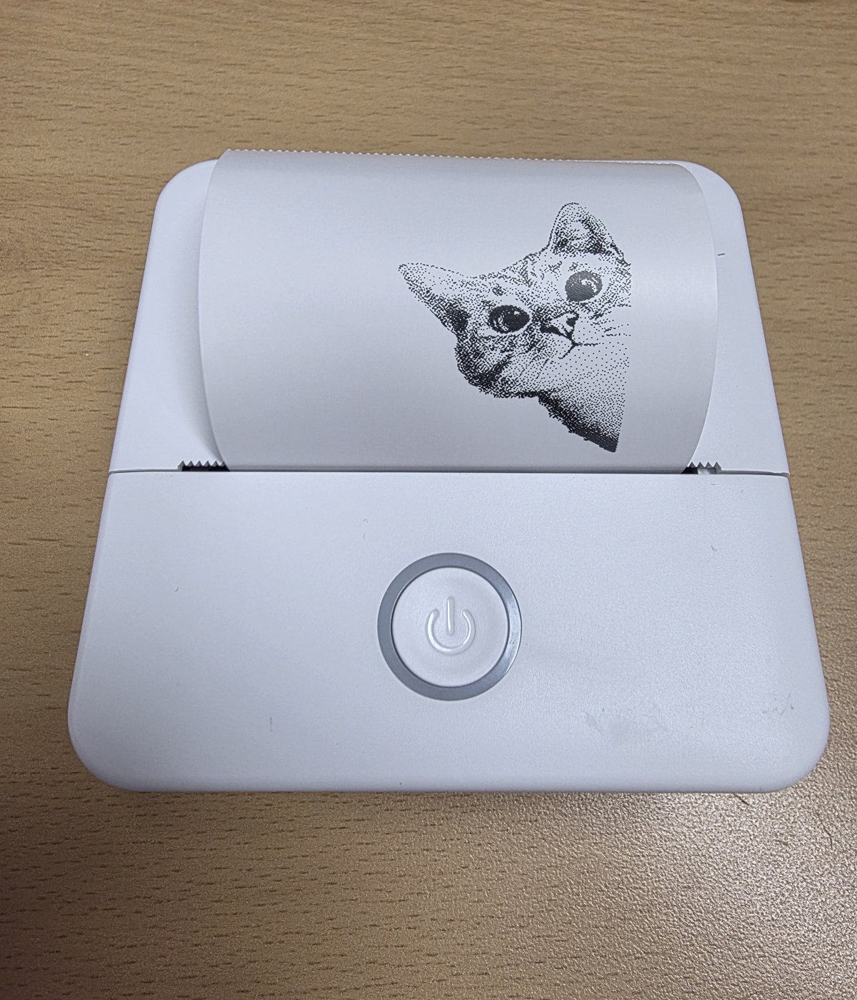

# Cat Printer 사용 안내

[메인](../../README.ko.md) | [English](../user-guide.md)

## 사진



## 지원 모델

[`models_data.py`](../../custom_components/catprinter/catprinter_ble/models_data.py)의 125개 모델(1–3인치 헤드) 중 `<모델>-XXXX` 형식의 광고 이름을 해당 MTU·전송 간격·열량 프로파일로 자동 인식합니다. 테이블에 있다고 실물 지원이 확인된 것은 아닙니다.

| 구분 | 모델 |
|---|---|
| 기존 실물 확인 | X6h, 펌웨어 3.0.5D — 로컬 어댑터 및 ESPHome Bluetooth 프록시 |
| 동일 프로토콜·미검증 | GB01, GB02, GB03(+SH/PH/PL/SL), GB04–06, GT01–04, X5/X6/X7 (+h/H/HP), X2h, X100–X103, SC03/SC04, LY01–05, P1/P2/P5/P6/P7, PR02/PR07, S101/S102, DY01/DY03, LT01, 58P5, WL01, M2 및 테이블의 나머지 모델 |
| 미지원 | FL01, KF-5, CP01, JRX01, QDX01, RS9000, DY49, SeznikNeo, WJ-HOT-PRT, wts07, XiaoWa: 모델별 D1 비밀키 필요. YMS-BT01: 다른 흐름 제어. 4/8인치 A4 및 Wi-Fi 모델: 다른 데이터 경로 |

X5h/X6h/X7h/P7 등은 주로 Bluetooth Classic SPP로 구동되지만 HA는 이를 사용하지 않습니다. 이 통합은 같은 프로토콜의 BLE GATT 경로를 사용하며 X6h에서 확인됐습니다. 테이블 모델이 응답하지 않으면 광고 이름을 비식별 형태로 제보하세요. `X6h`와 `X6H`는 열량 설정이 다른 별도 모델이며 대소문자를 구분합니다.

## 설치와 연결

1. HACS 사용자 지정 저장소(통합)에 이 리포를 추가하거나 `custom_components/catprinter`를 HA의 `custom_components/`에 복사합니다.
2. HA를 재시작하고 **설정 → 기기 및 서비스**에서 켜진 프린터를 확인합니다.
3. **통합 추가 → Cat Printer**에서 발견한 기기를 고릅니다. 인식한 기기가 없으면 주소·모델 수동 입력으로 넘어갑니다.

시험 중 휴대전화 Bluetooth 설정으로 프린터를 페어링하지 마세요. 동시에 다른 앱이 연결하지 않도록 연결을 종료합니다. 프린터 전원을 켜고 모델에 맞는 방법으로 깨운 뒤 용지를 넣고 커버를 닫습니다. 통합에서 D1 비밀키를 입력하는 인증 흐름은 제공하지 않습니다.

## 엔티티

실제 entity ID는 기기명·registry 변경에 따라 달라집니다.

| 엔티티 접미사 | 종류 | 데이터 |
|---|---|---|
| `sensor.*_status` | 상태 | `ok`, `printing`, `out_of_paper`, `cover_open`, `overheating` |
| `binary_sensor.*_out_of_paper`, `cover_open`, `overheating` | 상태 | 상태 비트 |
| `binary_sensor.*_printing` | 상태 | 현재 인쇄 중 여부 |
| `image.*_last_print` | 이미지 | 마지막 렌더링 이미지 |
| `sensor.*_battery` | 진단 | 모델별 방식으로 해석한 A3 응답 |
| `sensor.*_conditions` | 진단 | 활성 상태 비트를 쉼표로 연결 |
| `sensor.*_print_duration` | 진단 | 마지막/현재 인쇄 시간. 완료 후 속성에 BLE 경로·단계별 시간·실패 원인 |
| `sensor.*_last_failure` | 진단 | 마지막 BLE 실패 시각, `failed_stage`, `error`, `likely_cause`, 경로 속성. 다음 실패까지 보존 |
| `sensor.*_error_count` | 진단 | entry 로딩 이후 실패 수. 연결 전 실패한 상태 폴링은 제외 |
| `sensor.*_label_sensor` | 진단·기본 비활성 | 원시 라벨 센서 바이트 |
| `binary_sensor.*_low_battery`, `charging` | 진단 | 상태 비트 |
| `binary_sensor.*_connection` | 진단 | 현재 연결 상태 |

## 인쇄 작업

`catprinter.print`는 [imagespec](https://pypi.org/project/imagespec/) payload를 사용합니다. 텍스트·QR 코드를 함께 인쇄하는 예:

```yaml
action: catprinter.print
target:
  device_id: YOUR_PRINTER_DEVICE_ID
data:
  payload:
    - type: text
      value: "{{ states('sensor.outdoor_temperature') }} °C"
      x: 8
      y: 8
      size: 40
    - type: qrcode
      data: https://www.home-assistant.io
      x: 8
      y: 64
      size: 120
  height: 200
  mode: image
  density: 4
  feed: 96
```

`mode`는 `image` 또는 열량을 높여 선명하게 하는 `text`입니다. `density`는 1–7(기본 4), 단계당 약 ±15% 열량입니다. `feed`는 마지막 행 뒤로 밀어낼 도트 수입니다. 원시 `energy`(0–65535), `speed`(행 지연, 작을수록 빠름), `copies`, `rotate`, `preview`도 지정할 수 있습니다. 캔버스 너비는 헤드 너비(2인치 모델은 384px)로 고정하고 `height`만 정합니다. 응답은 렌더링 PNG data URL과 사용한 열량·속도를 포함합니다.

### URL 이미지 인쇄

```yaml
action: catprinter.print
target:
  device_id: YOUR_PRINTER_DEVICE_ID
data:
  feed: 0
  density: 3
  mode: image
  payload:
    - type: dlimg
      url: https://example.org/image.jpg
      x: 10
      y: 10
      xsize: 312
      ysize: 312
      dither: atkinson
  height: 332
```

URL은 실제 이미지 직접 주소로 바꾸세요. `height`는 `y + ysize + 여백` 등 인쇄 높이에 맞춰 직접 조절해야 용지 끝 이동이 맞습니다.

### 용지 이동

`catprinter.feed`는 `dots`행만큼 용지를 이동합니다. 203dpi에서는 8도트가 약 1mm입니다.

## 조정 옵션

**설정 → 기기 및 서비스 → Cat Printer → 구성**에서 조정하고 변경 시 entry를 다시 로딩합니다.

- **상태 조회 주기:** 기본 15분. 기존 X6h 관찰상 유휴 상태에서 최소 한 시간 켜져 연결 가능했고, 유휴 BLE 링크는 약 8분 뒤 끊겼습니다. 기본은 영구 연결 대신 연결–조회–해제입니다. 모든 모델의 절전 시간 보장은 아닙니다.
- **연결 유지:** 기본 꺼짐. 성공한 링크를 유지하면 프록시 연결 슬롯을 차지합니다.
- **패킷 간격:** 0은 자동. 로컬은 모델 프로파일(보통 2–6ms), ESPHome 프록시는 최소 20ms. 줄이 빠지면 간격을 늘려 확인합니다.
- **최대 패킷 크기:** 협상한 MTU와 별도로 상한을 둡니다. 프록시는 자동으로 최대 100바이트로 제한합니다. 큰 write-without-response 패킷을 수 ms 간격으로 보내면 ESP32에서 누락돼 줄이 깨지거나 조기 중단될 수 있습니다.

## 프로토콜·문제 해결

[프로토콜 원문 (영어)](../protocol.md)은 프레임·CRC·명령·행 인코딩·상태·인쇄 순서·프로파일 표 구조를 설명합니다. `tools/probe.py`는 HA 밖에서 GATT 응답을 확인하고 `tools/print_test.py`는 테스트 띠를 실제로 인쇄합니다. 인쇄는 용지를 사용하므로 명령의 옵션을 확인한 뒤 사용하세요.

[문제 해결](troubleshooting.md) · [개발·테스트](../development.md)

두 독립 도구 모두 용지 이동이나 인쇄를 수행하므로 읽기 전용 검사가 아닙니다. 소스·옵션을 확인하고 HA·다른 앱 연결을 종료한 별도 실험에서 사용하세요.
